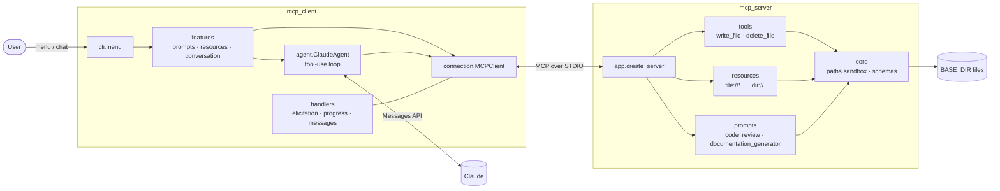

# Enhanced MCP Server — File Operations with Claude

A Model Context Protocol (MCP) server and command-line client that let **Claude** read, write and delete files and run guided workflows (code review and documentation generation). The project uses all three MCP primitives (**tools**, **resources** and **prompts**) and the advanced MCP Context features: **logging**, **progress reporting** and **user elicitation**.

> ## 📌 Credits and origin
>
> **The original code comes from the IBM Skills Network guided lab _"Build an Enhanced MCP Server"_, part of the [IBM RAG and Agentic AI Professional Certificate](https://www.coursera.org/specializations/ibm-rag-and-agentic-ai) on Coursera.**
>
> - **Original authors (IBM):** Abdul Fatir, Joshua Zhou and Joseph Santarcangelo (Data Scientists @ IBM)
> - **Original repository:** <https://github.com/joshuazhou744/enhanced-mcp-server> (the lab starts from its `start` branch)
> - **License:** the lab content is licensed under the [Apache License 2.0](LICENSE). See [`NOTICE`](NOTICE).
>
> This repository is my completed version of that lab, **refactored into a modular package layout** with configuration, tests and documentation added. The core design and behavior belong to the original authors. The structural changes are listed in [Changes from the original lab](#changes-from-the-original-lab).

---

## Table of contents

1. [What it does](#what-it-does)
2. [MCP in 60 seconds](#mcp-in-60-seconds)
3. [Architecture](#architecture)
4. [Project structure](#project-structure)
5. [Components](#components)
6. [Setup](#setup)
7. [Configuration](#configuration)
8. [How to use it](#how-to-use-it)
9. [Usage examples](#usage-examples)
10. [Using the pieces in your own code](#using-the-pieces-in-your-own-code)
11. [Extending the project](#extending-the-project)
12. [Testing](#testing)
13. [Changes from the original lab](#changes-from-the-original-lab)
14. [Troubleshooting](#troubleshooting)
15. [License](#license)

---

## What it does

| Menu option | What happens | MCP primitive / feature |
|---|---|---|
| **1. Generate Documentation** | The server asks you for a source file and a doc name, then Claude writes a Markdown doc file with the `write_file` tool | Prompt + **elicitation** + tool + **progress** |
| **2. Review Code** | You give a file path and Claude returns a full code review | Prompt (with arguments) |
| **3. Read File** | Prints a file's content | Resource **template** `file:///{file_name}` |
| **4. Read Current Directory** | Prints a table of files and folders | Static resource `dir://.` |
| **5. Converse with Agent** | A multi-turn chat where Claude can create and delete files | Tools + agentic loop |

Every file operation is sandboxed to a base directory (by default, the folder you launch from).

## MCP in 60 seconds

MCP is a standard way for LLM applications to connect to external capabilities. Instead of a custom API per integration, a **server** registers capabilities once and any MCP **client** can use them:

- **Tools**: *model-controlled* actions that change things (`write_file`, `delete_file`). Claude decides when to call them.
- **Resources**: *application-controlled*, read-only data addressed by URI (`dir://.`, `file:///{file_name}`). A resource with parameters in its URI is a **resource template**.
- **Prompts**: *user-controlled* templates that start a workflow (`code_review`, `documentation_generator`).

Through the **`Context`** object, server code can also **log** (`ctx.info/warning/error`), **report progress** (`ctx.report_progress`) and **elicit** structured input from the user mid-call (`ctx.elicit`).

## Architecture



**Request flow for "Converse with Agent":**

1. The client fetches the server's tool list and sends it to Claude with your question.
2. If Claude answers with `tool_use`, the client calls the tool on the MCP server (e.g. `write_file`).
3. The server writes the file in chunks, sending **progress notifications** and **log messages** back to the client.
4. The tool result goes back to Claude. The loop repeats until Claude gives a final answer (capped at `CLAUDE_MAX_TOOL_ROUNDS`).

## Project structure

```
enhanced-mcp-server/
├── server.py                      # Entry point: python server.py   (thin wrapper)
├── client.py                      # Entry point: python client.py server.py
│
├── mcp_server/                    # ── MCP SERVER ─────────────────────────────
│   ├── __main__.py                # python -m mcp_server
│   ├── app.py                     # create_server(): builds FastMCP + registers everything
│   ├── config.py                  # BASE_DIR, server name, progress settings (env-driven)
│   ├── core/
│   │   ├── paths.py               # get_path() sandbox guard, read_source_file()
│   │   └── schemas.py             # DocumentGeneratorSchema (elicitation model)
│   ├── tools/
│   │   ├── __init__.py            # register_tools()
│   │   └── file_tools.py          # write_file, delete_file
│   ├── resources/
│   │   ├── __init__.py            # register_resources()
│   │   ├── file_resources.py      # file:///{file_name}  (resource template)
│   │   └── directory_resources.py # dir://.              (static resource)
│   └── prompts/
│       ├── __init__.py            # register_prompts()
│       ├── code_review.py         # code_review(file_path)
│       └── documentation.py       # documentation_generator() with elicitation
│
├── mcp_client/                    # ── MCP CLIENT ─────────────────────────────
│   ├── __main__.py                # python -m mcp_client server.py
│   ├── app.py                     # wiring + build_menu()
│   ├── config.py                  # model, max tokens, tool-round limit (env-driven)
│   ├── connection.py              # MCPClient: connect/cleanup + MCP API helpers
│   ├── handlers.py                # elicitation, progress and notification callbacks
│   ├── agent.py                   # ClaudeAgent: agentic tool-use loop
│   ├── features/
│   │   ├── prompts.py             # run_prompt()
│   │   ├── resources.py           # read_file(), read_dir()
│   │   └── conversation.py        # converse() with multi-turn history
│   └── cli/
│       ├── menu.py                # MenuItem registry + run_menu()
│       └── display.py             # directory table, prompt info
│
├── tests/                         # pytest suite (in-memory + STDIO end-to-end)
├── requirements.txt / requirements-dev.txt
├── .env.example
├── LICENSE                        # Apache 2.0
└── NOTICE                         # attribution to the original IBM lab
```

**Design principle:** one module per capability, and one small registry per primitive. Adding a feature means adding a function and one line to a list; no other file needs to change.

## Components

### Server (`mcp_server`)

| Component | Kind | Description |
|---|---|---|
| `write_file(file_path, content)` | Tool | Creates or overwrites a UTF-8 file, creating parent folders as needed. Writes in ~10 chunks and calls `ctx.report_progress` after each one. Logs success or error through `ctx`. |
| `delete_file(file_path)` | Tool | Deletes a regular file only. Directories and missing paths return a message and a `ctx.warning`. |
| `file:///{file_name}` | Resource template | Returns `{"file_content": ...}` or `{"error": ...}`. Nested paths must be URL-encoded (`file:///src%2Fapp.py`). Three slashes because `file://` expects a host, and the host here is empty (local). |
| `dir://.` | Static resource | Returns `{"items": [...]}` with `name`, `path`, `type`, `size`, `modified` and `created` for every entry in `BASE_DIR`, directories first. |
| `code_review(file_path)` | Prompt | Reads the file and builds an "expert code editor" review prompt. Its input arrives as a normal **prompt argument**. |
| `documentation_generator()` | Prompt | Has **no arguments**. It calls `ctx.elicit(...)` with `DocumentGeneratorSchema` to ask the user for `file_path` and `name`, then builds a prompt telling Claude to save the docs with the `write_file` tool under exactly that name. |
| `core.paths.get_path` | Helper | Resolves a path against `BASE_DIR` and rejects anything that escapes it (`..`, absolute paths, symlinks) with `PathOutsideBaseDirError`. |

### Client (`mcp_client`)

| Component | Responsibility |
|---|---|
| `connection.MCPClient` | Owns the FastMCP `Client` and an `AsyncExitStack`. It launches the server script over STDIO (or accepts an in-memory server) and exposes `list_tools_for_claude()`, `call_tool_text()`, `get_prompt_text()`, `read_resource_json()` and more. It works as an async context manager. |
| `handlers` | `make_elicitation_handler()` asks for each schema field in the terminal; an empty answer declines. `handle_progress()` prints percentages. `handle_message()` prints server notifications. |
| `agent.ClaudeAgent` | The agentic loop: send the query and tools to Claude, run each `tool_use` block via MCP, return the `tool_result` blocks, and repeat. Tool errors go back to Claude as `is_error` results so it can recover. |
| `features.*` | One coroutine per menu action. Each one receives its dependencies (`mcp`, `agent`, `input_fn`), so it can be tested without a terminal. |
| `cli.menu` | `MenuItem(key, label, action)` dataclass and a generic `run_menu()` loop. |

## Setup

**Requirements:** Python 3.10+ and an [Anthropic API key](https://console.anthropic.com/) for the Claude-powered options (1, 2 and 5). Options 3 and 4 work without a key.

```bash
# 1. Get the code
git clone <your-repo-url> enhanced-mcp-server
cd enhanced-mcp-server

# 2. Create and activate a virtual environment
python -m venv .venv
source .venv/bin/activate          # Windows: .venv\Scripts\activate

# 3. Install dependencies
pip install -r requirements.txt    # add -dev to also install pytest

# 4. Add your API key
cp .env.example .env
#   then edit .env:  ANTHROPIC_API_KEY=sk-ant-...
```

## Configuration

All settings are optional environment variables (or `.env` entries):

| Variable | Default | Used by | Purpose |
|---|---|---|---|
| `ANTHROPIC_API_KEY` | — | client | Required for options 1, 2 and 5 |
| `CLAUDE_MODEL` | `claude-sonnet-5` | client | Claude model ID (the lab's default) |
| `CLAUDE_MAX_TOKENS` | `4096` | client | Max tokens per response |
| `CLAUDE_MAX_TOOL_ROUNDS` | `10` | client | Safety cap on tool-use iterations per query |
| `MCP_BASE_DIR` | current directory | server | Sandbox root for all file operations |
| `MCP_SERVER_NAME` | `File Operations MCP Server` | server | Name advertised to clients |
| `MCP_WRITE_PROGRESS_STEPS` | `10` | server | Number of progress updates per `write_file` |
| `MCP_WRITE_PROGRESS_DELAY` | `0.05` | server | Pause between chunks (makes progress visible) |

## How to use it

From the project root:

```bash
python client.py server.py
# equivalent: python -m mcp_client server.py
```

The client starts the server as a subprocess and talks to it over STDIO:

```
MCP Client Started!
Select from the menu or 'quit'/'q' to exit.

Select from the Menu
1. Generate Documentation
2. Review Code
3. Read File
4. Read Current Directory
5. Converse with Agent
q. Quit
>
```

The server's own logs (FastMCP banner, `Server log: ...` lines) go to **stderr**, so they appear in the same terminal without breaking the protocol stream.

To run the server on its own (for example, for another MCP client):

```bash
python server.py           # or: python -m mcp_server
```

## Usage examples

### Read a file (resource template)

```
> 3
Enter file path: mcp_server/core/schemas.py
File Content:
 """Pydantic schemas used for structured user elicitation."""
...
```

A path outside the sandbox or a missing file prints the server's error message, for example `Error: missing.py is not a valid file`.

### List the directory (static resource)

```
> 4

Directory Listing:

Type                Size  Modified                   Name
---------------------------------------------------------------------------
📁  directory     4096 B  2026-11-16T16:32:05.325197 mcp_client
📁  directory     4096 B  2026-11-16T16:32:03.956165 mcp_server
📄  file           256 B  2026-11-16T16:31:20.670860 client.py
📄  file           288 B  2026-11-16T16:31:19.578860 server.py
```

### Review code (prompt with arguments)

```
> 2

Prompt: code_review
  Generate a prompt asking Claude for a code review of a file.
  Arguments: file_path
file_path (required): mcp_client/agent.py
Received: notifications/message
<Claude's review: strengths, issues, suggestions...>
```

### Generate documentation (prompt + elicitation + tool + progress)

```
> 1

Prompt: documentation_generator
  Generate a prompt asking Claude to write a documentation file.
  Arguments: none (the server may ask for inputs via elicitation)
Server asks: Please provide the subject file name and the documentation file name
Enter value for 'file_path' (str): mcp_server/tools/file_tools.py
Enter value for 'name' (str): FILE_TOOLS_DOCS
Received: notifications/message
Progress: 10.0% - Writing progress: 312/3120
Progress: 20.0% - Writing progress: 624/3120
...
Progress: 100.0% - Write complete
<Claude: "I've created FILE_TOOLS_DOCS.md documenting write_file and delete_file...">
```

Leave any field empty to **decline** the elicitation. The server then cancels the prompt.

### Converse with the agent (tools + agentic loop)

```
> 5

Entering conversation mode. Type 'quit' or 'q' to exit.

Query: Create notes/todo.md with a checklist for adding a new MCP tool
Progress: 10.0% - Writing progress: 41/415
...
<Claude confirms it created notes/todo.md>

Query: Now delete it
<Claude calls delete_file and confirms>

Query: q
```

Conversation mode keeps the history until you exit, so follow-ups like "now delete it" work.

### Things to try

- Ask the agent to write a small script, then use **Review Code** on it.
- Ask the agent to write outside the folder (`../x.txt`). The sandbox rejects it, and Claude receives the error and explains it.
- Watch the `Progress:` lines (from `ctx.report_progress`) and the `Server log:` lines (from `ctx.info`).

## Using the pieces in your own code

**Drive the server from Python** (in-memory, no subprocess):

```python
import asyncio, json
from mcp_client import MCPClient, ClaudeAgent
from mcp_server import create_server

async def main():
    async with MCPClient() as mcp:
        await mcp.connect(create_server())          # or: await mcp.connect("server.py")
        listing = await mcp.read_resource_json("dir://.")
        print([item["name"] for item in listing["items"]])

        agent = ClaudeAgent(mcp)                    # needs ANTHROPIC_API_KEY
        print(await agent.process_query("Create hello.txt containing 'hi'"))

asyncio.run(main())
```

**Use the server from another MCP host** (for example, Claude Desktop's `claude_desktop_config.json`). Use absolute paths:

```json
{
  "mcpServers": {
    "file-ops": {
      "command": "/abs/path/enhanced-mcp-server/.venv/bin/python",
      "args": ["/abs/path/enhanced-mcp-server/server.py"],
      "env": { "MCP_BASE_DIR": "/abs/path/to/the/folder/to/expose" }
    }
  }
}
```

## Extending the project

Each primitive has a registry, so extending is "write a function, add it to a list".

**Add a tool.** For example, add a `rename_file` tool in `mcp_server/tools/file_tools.py`:

```python
async def rename_file(src: str, dst: str, ctx: Context) -> str:
    """Rename a file inside the project directory."""
    get_path(src).rename(get_path(dst))
    await ctx.info(f"Renamed {src} -> {dst}")
    return f"Renamed {src} -> {dst}"

TOOLS = [write_file, delete_file, rename_file]
```

Claude sees it automatically, because the agent fetches the tool list for every query. For a new *group* of tools, create `mcp_server/tools/search_tools.py` with its own `TOOLS` list and add the module to `_MODULES` in `mcp_server/tools/__init__.py`.

**Add a resource.** Add `(uri, function)` to a module's `RESOURCES` list:

```python
async def file_stats(file_name: str) -> dict:
    path = get_path(file_name)
    return {"lines": len(path.read_text().splitlines())}

RESOURCES = [(FILE_URI_TEMPLATE, read_file_resource), ("stats:///{file_name}", file_stats)]
```

**Add a prompt.** Create `mcp_server/prompts/unit_tests.py` with an `async def unit_tests(file_path: str, ctx: Context) -> str` function and `PROMPTS = [unit_tests]`, then add the module to `_MODULES` in `mcp_server/prompts/__init__.py`. Reuse `read_source_file()` to load the code.

**Add a menu option.** Add one line to `build_menu()` in `mcp_client/app.py`:

```python
MenuItem("6", "Write Unit Tests", lambda: run_prompt(mcp, agent, "unit_tests")),
```

## Testing

```bash
pip install -r requirements-dev.txt
pytest -q
```

The suite (21 tests) needs **no API key**:

- `tests/test_server.py` covers every tool, resource and prompt through an in-memory FastMCP client, plus progress reporting, elicitation (accept and decline) and sandbox escapes.
- `tests/test_client.py` runs the agent loop against a scripted fake Claude (tool calls, tool errors, round limit, conversation history), tests the features and the menu, and includes a real **STDIO end-to-end** run of `python client.py server.py`.

## Changes from the original lab

The behavior, prompts and menu match the lab. These are the structural changes and fixes:

| Area | Original | Now |
|---|---|---|
| Layout | Two files (`server.py`, `client.py`) | `mcp_server` / `mcp_client` packages, one module per capability, registries per primitive; root scripts kept as thin entry points |
| Path safety | `get_path` resolved against the process CWD and returned a *relative* path | Resolves against `BASE_DIR`, returns an absolute path, raises `PathOutsideBaseDirError` on escape |
| `write_file` | `time.sleep()` blocked the event loop | `await asyncio.sleep()` |
| Server startup message | `print()` to stdout (shares the STDIO protocol channel) | Printed to stderr |
| Elicitation | A declined or cancelled elicitation read `result.data` (which doesn't exist on that result), so the client got a generic "Error rendering prompt" | Checks `result.action` first and returns a clear message |
| Read File | A missing file showed `Error reading file: 'file_content'` | Shows the server's actual error message |
| Claude client | Synchronous `Anthropic` inside async code; no loop limit | `AsyncAnthropic`, created lazily (resources work without a key), `CLAUDE_MAX_TOOL_ROUNDS` cap, clear message when the key is missing |
| Conversation | Each query started from scratch | History kept for the session (rolled back on errors) |
| Config | Hard-coded constants | Environment variables / `.env` |
| Tests | None | 21 pytest tests including STDIO end-to-end |

## Troubleshooting

- **`ANTHROPIC_API_KEY is not set`**: create `.env` from `.env.example`. Options 3 and 4 work without it.
- **`Server script must be a .py, .js, or .ts file`**: run `python client.py server.py` from the project root.
- **Model not found / 404 from the API**: set `CLAUDE_MODEL` in `.env` to a model your key can access.
- **Changes to the server don't show up**: restart the client. It launches a fresh server process on start.
- **`ModuleNotFoundError: mcp_server`**: run the commands from the project root with the virtual environment active.
- **Dependency conflicts**: keep the pinned versions in `requirements.txt`, including `pydantic<2.14` as the lab specifies.

## License

Licensed under the **Apache License 2.0**, the same license as the original IBM lab content. See [`LICENSE`](LICENSE) and [`NOTICE`](NOTICE).

Original lab: *Build an Enhanced MCP Server*, IBM Skills Network, from the **IBM RAG and Agentic AI Professional Certificate**. Authors: Abdul Fatir, Joshua Zhou, Joseph Santarcangelo. Original code: <https://github.com/joshuazhou744/enhanced-mcp-server>.
